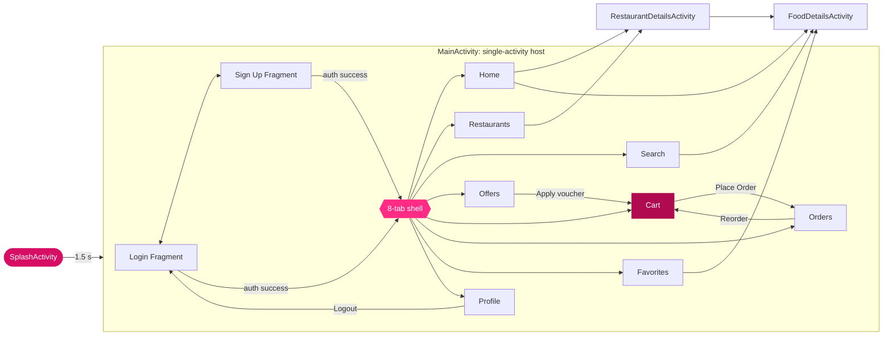
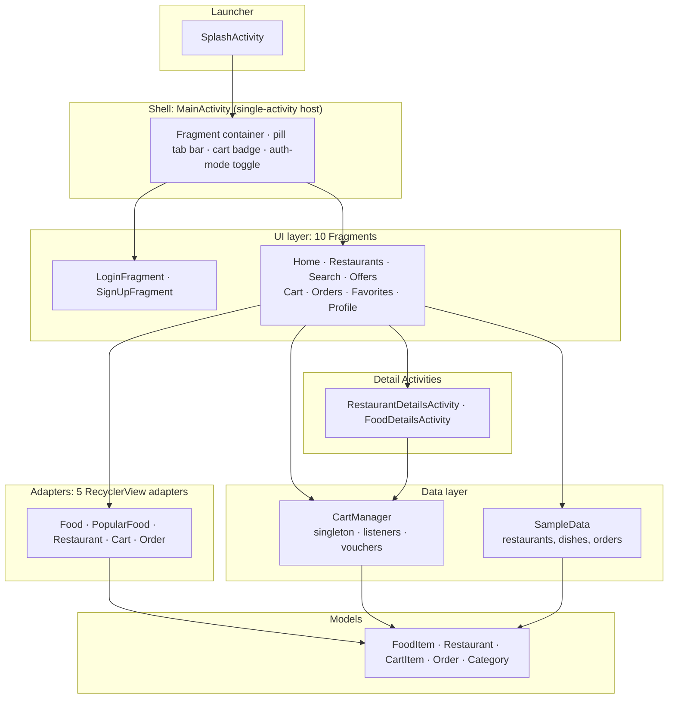
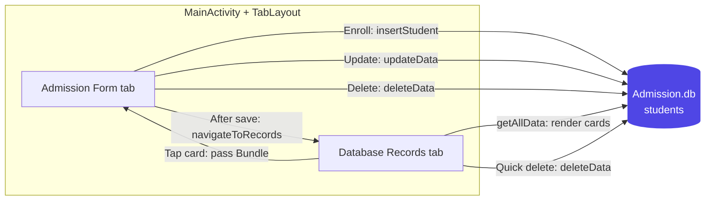

<div align="center">


<br/>


-brightgreen?style=flat-square&logo=android)


**Four standalone Android Studio projects, one repository.**
A Compose starter, a ListView vs RecyclerView comparison, a fragment-based food-delivery app, and a SQLite-backed student admission app with full CRUD.

[Projects](#-projects-at-a-glance) · [Foodie](#-foodie--food-delivery-app) · [Lists](#-lists--listview-vs-recyclerview) · [MyApplication](#-myapplication--jetpack-compose-starter) · [Database](#%EF%B8%8F-database--student-admission-app-sqlite) · [Getting Started](#-getting-started)

</div>

---

## ✨ About

This repository holds the lab tasks and assignments from my **Mobile App Development** course at The Superior University, Lahore. Every project folder is a **self-contained Android Studio project** with its own Gradle configuration, so you can open any one of them directly without touching the others.

The projects are arranged as a progression:

| Stage | What it teaches | Project |
|:-:|---|---|
| 🟢 **1** | Project setup, modern declarative UI with Compose | **MyApplication** |
| 🔵 **2** | Displaying collections: `ListView` vs `RecyclerView`, custom adapters, data models | **Lists** |
| 🔴 **3** | A complete app: single-activity architecture, fragment navigation, in-fragment auth flow, shared state, vouchers | **Foodapp** |
| 🟣 **4** | Local persistence: SQLite with `SQLiteOpenHelper`, full CRUD, photo picker, form validation | **Database** |

---

## 📦 Projects at a Glance

| Project | Language | UI Toolkit | Package | Highlights |
|---|---|---|---|---|
| 🍔 [`Foodapp`](Foodapp) | Java | XML + Material Components | `com.example.foodapp` | Single-activity shell, Login/Sign-up as fragments, 8-tab navigation, cart singleton, vouchers |
| 📱 [`Lists`](Lists) | Java | XML + Material Components | `com.example.lists` | Two adapters, one dataset, direct comparison |
| 🧩 [`MyApplication`](MyApplication) | Kotlin | Jetpack Compose | `com.example.myapplication` | Compose + Material 3 theming, edge-to-edge |
| 🗄️ [`Database`](Database) | Java | XML + Material Components | `com.example.database` | SQLite CRUD, tabbed fragments, photo picker, validated admission form |

<table>
<tr>
<td width="50%" valign="top">

### 🍔 Foodie
**Food-delivery app**

`Java` `XML` `Material` `Fragments` `RecyclerView`

Single-activity shell · 10 fragments · 6 restaurants · 24 dishes · live search · voucher engine · working cart and order flow.

*Best for seeing how screens, shared state and data come together in one app.*

</td>
<td width="50%" valign="top">

### 🗄️ Database
**Student admission app**

`Java` `SQLite` `Fragments` `Material`

Enroll, view, edit and delete students stored in a local SQLite database, with profile photos and live validation.

*Best for seeing how persistence works end to end.*

</td>
</tr>
<tr>
<td width="50%" valign="top">

### 📱 Lists
**ListView vs RecyclerView**

`Java` `XML` `Material 3`

20 flagship smartphones shown two ways, side by side, with brand logos and ratings.

*Best for understanding how the two list approaches differ in practice.*

</td>
<td width="50%" valign="top">

### 🧩 MyApplication
**Jetpack Compose starter**

`Kotlin` `Compose` `Material 3`

Edge-to-edge Compose scaffold with a themed Material 3 setup.

*Best for seeing the modern declarative way to build Android UI.*

</td>
</tr>
</table>

---

## 🍔 Foodie — Food Delivery App

> A Foodpanda-inspired ordering app with a pink brand palette, built entirely with Java, XML layouts and Material Components. It follows a **single-activity architecture**: one `MainActivity` hosts **10 fragments**, including the **Login and Sign-up screens**, plus a scrollable 8-tab bar for browsing, searching, offers, cart, orders, favorites and profile. Only two dedicated detail screens (restaurant and food) live outside the shell. All data is local sample data, so it runs with **no backend and no API keys**.

### 🎯 Features

- 🚀 **Splash screen** with a 1.5 s timed hand-off into `MainActivity`, which opens straight on the **Login** fragment
- 🔐 **Login and Sign-up fragments** using Material `TextInputLayout`, scrollable on small screens, with inline validation (required fields, `@` check, minimum 4-character password, password confirmation on sign-up) and keyboard "Done" submit
- 🙈 **Auth mode**: the header bar and tab bar are hidden while Login/Sign-up is showing and revealed again after a successful sign-in
- 🧭 **8-tab fragment shell**: Home, Restaurants, Search, Offers, Cart, Orders, Favorites and Profile, in a scrollable pill tab bar (built dynamically in code) that auto-scrolls the selected tab into view
- 🏠 **Home tab** with delivery address, search bar, promo banner, category shortcuts (Pizza, Burgers, Sushi, Noodles, Desserts, Drinks), a popular-dishes carousel and featured restaurants
- 🛍️ **Live cart badge** in the header that updates instantly from anywhere in the app, plus a header cart button that jumps to the Cart tab
- 🔍 **Live search** that filters every dish by name, description and category as you type
- 🏪 **Restaurant browsing and detail pages** with menu items, ratings, delivery time, fee and a "View Cart" bar showing the live item count and total
- 🍽️ **Food detail page** with quantity selection and add-to-cart
- 🛒 **Shopping cart** with quantity controls, remove and clear, plus live subtotal, delivery fee, voucher discount and total
- 🎟️ **Working voucher engine**: apply a code on the Offers tab and the Cart tab recalculates immediately
- 📦 **Order placement** that adds a new order to history and jumps to the Orders tab from a confirmation dialog
- 🔁 **Order history** with status chips and a **reorder** shortcut that adds a dish to the cart and opens the Cart tab
- ❤️ **Favorites tab** with a curated list of dishes, quick-add and detail navigation
- 👤 **Profile tab** with address and payment shortcuts, an orders link and a logout that returns to the Login fragment

### 🎟️ Voucher Engine

Vouchers are applied through the shared `CartManager`, so every screen sees the same discount.

| Code | Effect | How it is calculated |
|---|---|---|
| `FOODIE50` | **50% off** the subtotal | `subtotal × 0.50` |
| `BURGER20` | **20% off** the subtotal | `subtotal × 0.20` |
| `FREEDEL` | **Free delivery** | Delivery fee drops from `$2.49` to `$0.00` |

- The Offers tab shows an applied voucher as **"✓ CODE Applied"** and disables the button, and restores that state when you come back.
- The Cart tab shows a dedicated discount row only when a voucher is active.
- The total is clamped so it can **never go below zero**.
- Clearing the cart (or placing an order) also clears the active voucher.

### 🗺️ Navigation Flow



### 🏗️ Architecture



### 🧠 Concepts Demonstrated

| Concept | Where it shows up |
|---|---|
| **Single-activity architecture** | `MainActivity` swaps 10 fragments (auth + 8 tabs) inside one container; only the two detail screens are separate activities |
| **Fragment ↔ host communication** | Fragments call `MainActivity.navigateToFragment()`, `showLoginFragment()`, `showSignUpFragment()` and `onAuthSuccess()` after an `instanceof` check |
| **Singleton + observer pattern** | `CartManager` notifies registered listeners (cart badge, cart tab, restaurant cart bar) whenever the cart changes |
| **Shared state as a single source of truth** | Cart, voucher and totals live in one place, so features like vouchers plug in cleanly |
| **RecyclerView + custom adapters** | Five adapters with click callbacks for item taps and quick-add |
| **Explicit intents + extras** | Passing a `Serializable` `FoodItem` / `Restaurant` from list screens to detail screens |
| **Form validation** | Login and sign-up error states on `TextInputLayout` |
| **Fragment lifecycle hygiene** | Listeners registered in `onViewCreated` and removed in `onDestroyView` to avoid leaks |
| **Model layer separation** | `model/`, `adapter/`, `data/` and `fragment/` packages kept apart from activities |
| **Custom drawables** | Vector icons plus shape backgrounds for badges, chips, cards, tabs and buttons |
| **Day and night themes** | `values` and `values-night` on a Material 3 DayNight base |

### 📊 Project Stats

| Metric | Count |
|---|---|
| Activities | 4 (Splash · Main · RestaurantDetails · FoodDetails) |
| Fragments | 10 (2 auth · 8 tabs) |
| RecyclerView adapters | 5 |
| Model classes | 5 |
| Layout files | 19 (4 activity · 10 fragment · 5 list item) |
| Restaurants · Dishes · Sample orders | 6 · 24 · 3 |
| Vector icons · Shape backgrounds | 26 · 11 |
| Image assets | 55 (dishes, restaurants, categories, sliders, clients, auth art) |

### 📁 Structure

```text
Foodapp/app/src/main/
├── java/com/example/foodapp/
│   ├── SplashActivity.java          launcher, 1.5 s delay, opens MainActivity on Login
│   ├── MainActivity.java            single-activity host: tab bar, cart badge, fragment swaps
│   ├── RestaurantDetailsActivity    FoodDetailsActivity
│   ├── fragment/                    Login · SignUp
│   │                                Home · Restaurants · Search · Offers
│   │                                Cart · Orders · Favorites · Profile
│   ├── adapter/                     Food · PopularFood · Restaurant · Cart · Order
│   ├── data/                        CartManager (cart + vouchers) · SampleData
│   └── model/                       CartItem · Category · FoodItem · Order · Restaurant
└── res/
    ├── layout/                      activity_* · fragment_* · item_*
    ├── drawable/                    vector icons + shape backgrounds + photos
    └── values/                      colors · strings · themes (+ values-night)
```

### 🎨 Palette

| Token | Hex | Use |
|---|---|---|
|  `foodie_pink` | `#D70F64` | Primary brand |
|  `foodie_pink_dark` | `#B00B50` | Pressed and dark states |
|  `foodie_pink_accent` | `#FF2B85` | Accents |
|  `foodie_pink_light` | `#FFF0F5` | Soft backgrounds |

---

## 📱 Lists — ListView vs RecyclerView

> One dataset, two implementations. The same 20 flagship smartphones are rendered with a classic `ListView` + `BaseAdapter` and with a modern `RecyclerView` + `ViewHolder`, so the differences are easy to see in code and in behavior.

### 🎯 Features

- 🏁 **Landing screen** with two entry cards, one per list technique
- 📋 **ListView screen** powered by `ListViewAdapter` and `item_gadget.xml`
- ⚡ **RecyclerView screen** powered by `RecyclerAdapter` with a proper `ViewHolder` and `item_gadget_recycler.xml`
- 📱 **20 flagship phones** (iPhone, Galaxy, Pixel, Xperia, OnePlus, Xiaomi and more), each with description, category badge, star rating and review count
- 🏷️ **20 custom vector brand logos** drawn as XML drawables, so there are no image assets and everything scales cleanly
- 🎨 **Indigo and violet Material 3 styling** with gradient headers, category badges and spec pills
- 📐 **Edge-to-edge** layout with window insets handled in code

### 🔬 The Comparison

| | `ListView` | `RecyclerView` |
|---|---|---|
| **Adapter** | `ListViewAdapter` | `RecyclerAdapter` |
| **Item layout** | `item_gadget.xml` | `item_gadget_recycler.xml` |
| **View recycling** | Manual (`convertView`) | Built in via `ViewHolder` |
| **Layout flexibility** | Vertical list only | Pluggable `LayoutManager` |
| **Screen** | `ListViewActivity` | `RecyclerActivity` |

### 📁 Structure

```text
Lists/app/src/main/
├── java/com/example/lists/
│   ├── MainActivity.java            entry screen, routes to both demos
│   ├── ListViewActivity.java        ListView demo
│   ├── RecyclerActivity.java        RecyclerView demo
│   ├── ListViewAdapter.java         BaseAdapter implementation
│   ├── RecyclerAdapter.java         RecyclerView.Adapter + ViewHolder
│   ├── Gadget.java                  model: name, description, category, rating, reviews, icon
│   └── GadgetProvider.java          the 20-device dataset
└── res/
    ├── layout/                      activity_main · activity_list_view · activity_recycler · item_gadget · item_gadget_recycler
    └── drawable/                    20 ic_logo_*.xml brand vectors + gradient/badge/pill backgrounds
```

---

## 🧩 MyApplication — Jetpack Compose Starter

> The first project of the course: a clean Android Studio **Empty Activity (Compose)** scaffold, used to set up the toolchain and explore the declarative UI model.

### 🎯 What's inside

- 🧱 `ComponentActivity` hosting a Compose UI through `setContent`
- 📐 `enableEdgeToEdge()` with a `Scaffold` that applies inner padding
- 🎨 Material 3 theme split into `Color.kt`, `Type.kt` and `Theme.kt`
- 👀 `@Preview` composable for instant previews inside Android Studio
- 🧪 Compose UI test and tooling dependencies wired up through the Compose BOM

### 🛠️ Stack

| Component | Version / Choice |
|---|---|
| Language | Kotlin `2.2.10` |
| UI | Jetpack Compose (BOM `2026.02.01`) + Material 3 |
| Android Gradle Plugin | `9.4.0` |
| Min / Target SDK | `24` / `37` |

### 📁 Structure

```text
MyApplication/app/src/main/java/com/example/myapplication/
├── MainActivity.kt        Compose entry point + Greeting composable
└── ui/theme/
    ├── Color.kt
    ├── Type.kt
    └── Theme.kt
```

---

## 🗄️ Database — Student Admission App (SQLite)

> A student admission manager backed by a local **SQLite** database (`Admission.db`) through a hand-written `SQLiteOpenHelper`. A single `MainActivity` hosts two fragments behind a `TabLayout`: an **Admission Form** for enrolling and editing students, and a **Database Records** screen that lists every student as a card. It covers the full **Create, Read, Update, Delete** cycle with no ORM and no backend.

### 🎯 Features

- 📝 **Admission form** with name, email, phone and password fields in Material `TextInputLayout`s, plus a degree-program dropdown, a gender radio group, specialization checkboxes and a confirmation checkbox
- ✅ **Inline validation**: required fields, `Patterns.EMAIL_ADDRESS` email check, degree selection and a terms checkbox that must be ticked before enrollment
- ➕ **Insert**: "Enroll" saves a new student, clears the form and jumps to the Records tab
- ✏️ **Update**: tap a card (or its edit icon) and the form opens pre-filled through a fragment `Bundle`; change fields and update by student ID
- 🗑️ **Delete**: from the form by ID, or straight from a card, both behind a `MaterialAlertDialogBuilder` confirmation
- 📷 **Profile photo picker** using `ActivityResultContracts.GetContent`, with the image URI stored in the database and a persistable read permission requested
- 🪪 **Student cards** showing an avatar (photo or initial), ID chip, email and colored pills for gender, course, department and specialization
- 🔢 **Live counters** for total students, and an **empty state** with a shortcut back to the form
- 🎨 **Indigo and cyan Material styling** with gradient headers, vector icons and a day/night theme pair

### 🧱 Database Schema

**Database:** `Admission.db` · **Version:** `5` · **Table:** `students`

| Column | Type | Notes |
|---|---|---|
| `id` | `INTEGER` | `PRIMARY KEY AUTOINCREMENT` |
| `username` | `TEXT` | Student full name |
| `email` | `TEXT` | Validated on the form |
| `phone` | `TEXT` | Contact number |
| `password` | `TEXT` | See [Known limitations](#-known-limitations) |
| `gender` | `TEXT` | `Male` · `Female` · `Other` |
| `course` | `TEXT` | One of 6 degree programs (BSCS, BSSE, BSAI, BSDS, Cyber Security, BSIT) |
| `facilities` | `TEXT` | Comma-separated specializations: Web Dev, AI & ML, Mobile App, Cyber & Cloud (default `General Tech`) |
| `department` | `TEXT` | Currently set to `Information Tech` by the form |
| `image_uri` | `TEXT` | Profile photo URI from the picker |

### ⚙️ `DatabaseHelper` API

| Method | SQL operation | Returns |
|---|---|---|
| `insertStudent(...)` | `INSERT` via `ContentValues` | New row ID, or `-1` on failure |
| `getAllData()` | `SELECT * ... ORDER BY id DESC` | `Cursor` (newest first) |
| `updateData(id, ...)` | `UPDATE ... WHERE id=?` | `true` if a row changed |
| `deleteData(id)` | `DELETE ... WHERE id=?` | `true` if a row was removed |
| `getRecordsCount()` | `SELECT COUNT(*)` | Total students as `int` |

All writes use `ContentValues` and `?` placeholders, so user input never gets concatenated into SQL.

### 🔄 CRUD Flow



### 🧠 Concepts Demonstrated

| Concept | Where it shows up |
|---|---|
| **SQLiteOpenHelper** | `DatabaseHelper` creates the schema in `onCreate` and handles versioning in `onUpgrade` |
| **CRUD with parameterized queries** | `ContentValues` for writes, `?` selection args for update and delete |
| **Cursor handling** | Records are read from a `Cursor` and closed after rendering; count uses try-with-resources |
| **Single shared helper** | Fragments obtain one `DatabaseHelper` from `MainActivity.getDatabaseHelper()` |
| **Fragment ↔ activity navigation** | `navigateToRecords()` and `navigateToAdmission(Bundle)` keep the tab selection in sync |
| **Passing data between fragments** | Student fields travel as a `Bundle` to pre-fill the form for editing |
| **Activity Result API** | `registerForActivityResult` with `GetContent` for the photo picker |
| **Material dialogs and snackbars** | Delete confirmation dialog, color-coded success and error snackbars |
| **Dynamic list rendering** | Each record inflates `item_student_card.xml` into a container, with gender-based styling |

### 📁 Structure

```text
Database/app/src/main/
├── java/com/example/database/
│   ├── MainActivity.java            host activity: TabLayout, fragment swaps, shared DatabaseHelper
│   ├── DatabaseHelper.java          SQLiteOpenHelper: schema + insert/query/update/delete/count
│   ├── AdmissionFragment.java       form, validation, photo picker, insert/update/delete actions
│   └── RecordsFragment.java         student cards, quick edit and quick delete, empty state
└── res/
    ├── layout/                      activity_main · fragment_admission · fragment_records · item_student_card
    ├── drawable/                    vector icons + pill, avatar, chip and gradient backgrounds
    └── values/                      colors · strings · themes (+ values-night)
```

### ⚠️ Known limitations

This is coursework, and these are deliberate gaps rather than hidden ones:

- **Passwords are stored as plain text** in the `password` column. A production app would store a salted hash, or avoid storing passwords locally at all.
- **`onUpgrade` drops and recreates the table**, so bumping `DATABASE_VERSION` wipes existing records. A real migration would use `ALTER TABLE`.
- **Queries run on the main thread.** That is fine at this scale; Room with background execution would be the next step.

---

## 🛠️ Tech Stack

| Area | Technologies |
|---|---|
| **Languages** | Java 11, Kotlin 2.2 |
| **UI** | XML layouts, Material Components 1.14, Jetpack Compose, Material 3 |
| **Navigation** | Single-activity fragment swaps (tab shell and `TabLayout`), explicit intents with extras for detail screens |
| **Persistence** | SQLite via `SQLiteOpenHelper` (Database project) |
| **Lists and data display** | `ListView`, `RecyclerView`, `BaseAdapter`, `RecyclerView.Adapter`, `ViewHolder` |
| **Patterns** | Singleton, observer (listeners), model/adapter/data separation |
| **Build** | Gradle 9.6 (Kotlin DSL), version catalogs (`libs.versions.toml`), Android Gradle Plugin 9.4 |
| **Testing scaffold** | JUnit 4, Espresso, AndroidX Test |
| **IDE** | Android Studio |

---

## 📂 Repository Structure

```text
mobile-app-development-coursework/
├── 🍔 Foodapp/            Food-delivery app (Java + XML + single-activity Fragments)
├── 📱 Lists/              ListView vs RecyclerView (Java + XML)
├── 🧩 MyApplication/      Jetpack Compose starter (Kotlin)
├── 🗄️ Database/           Student admission app (Java + SQLite CRUD)
└── 📄 README.md
```

---

## 🚀 Getting Started

### Prerequisites

- **Android Studio** (recent stable release)
- **JDK 11+** (bundled with Android Studio)
- An emulator or physical device running **Android 7.0 (API 24) or higher**

### Run a project

```bash
# 1. Clone the repository
git clone https://github.com/furqanzubair209-cell/mobile-app-development-coursework.git

# 2. Open ONE of the project folders in Android Studio
#    Foodapp  |  Lists  |  MyApplication  |  Database
```

3. Wait for the **Gradle sync** to finish.
4. Pick an emulator or connect a device, then press **▶ Run**.

> 💡 Each folder is its own Gradle project. Open `Foodapp`, `Lists`, `MyApplication` or `Database` directly, **not** the repository root.

### Quick tips per project

- 🍔 **Foodapp:** login and sign-up are **client-side only**, so any valid-looking email and a password of 4+ characters will sign you in. Try the vouchers `FOODIE50`, `BURGER20` and `FREEDEL` from the **Offers** tab.
- 🗄️ **Database:** enroll a student on the **Admission Form** tab, then open **Database Records**. Tap any card to load it back into the form for editing. Data lives in the app's private storage, so clearing app data or uninstalling resets it.

---

## 🗓️ Roadmap

- [x] Jetpack Compose starter project
- [x] ListView vs RecyclerView comparison
- [x] Multi-screen food-delivery app
- [x] SQLite-backed student admission app with full CRUD
- [x] Fragment-based tab navigation for Foodie
- [x] Refactor Foodie to a single-activity architecture (Login and Sign-up as fragments)
- [x] Voucher engine with live cart totals
- [ ] Persist Foodie's cart, orders and login locally (Room or SharedPreferences)
- [ ] Migrate the Database app to Room, hash stored passwords and add proper schema migrations
- [ ] Add search and filtering to the student records screen
- [ ] Replace sample data with a remote API
- [ ] Add UI tests for the Foodie order flow
- [ ] Upcoming lab tasks and assignments

---

## 👨‍💻 Author

<div align="center">

**Muhammad Furqan**  
Computer Science Student · The Superior University, Lahore

**GitHub:** [furqanzubair209-cell](https://github.com/furqanzubair209-cell) — source code for coursework, personal projects and experiments.  
**LinkedIn:** [muhammad-furqan-228807304](https://www.linkedin.com/in/muhammad-furqan-228807304) — professional profile, certificates and project updates.  
**Portfolio:** [furqannewportfolio.netlify.app](https://furqannewportfolio.netlify.app) — 28 projects across frontend, AI/ML and automation.

<br/>

⭐ If you found this useful, consider starring the repository.


</div>
