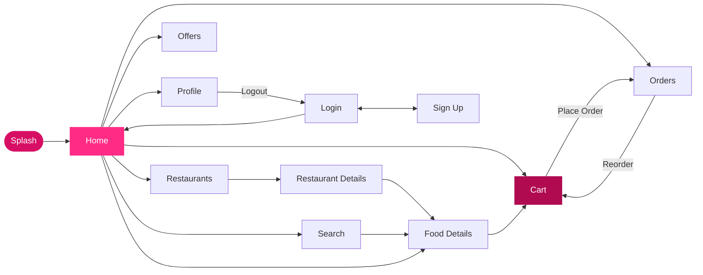
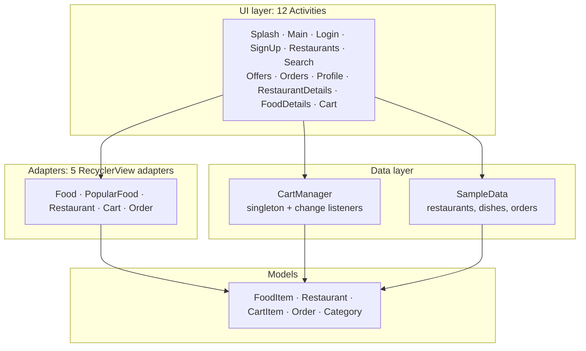

<div align="center">


<br/>


-brightgreen?style=flat-square&logo=android)


**Three standalone Android Studio projects, one repository.**
From a Compose starter, to a ListView vs RecyclerView showdown, to a full multi-screen food-delivery app.

</div>

---

## ✨ About

This repository holds the lab tasks and assignments from my **Mobile App Development** course at The Superior University, Lahore. Every folder is a **self-contained Android Studio project** with its own Gradle wrapper, so you can open any one of them directly without touching the others.

The projects are deliberately arranged as a progression:

| Stage | What it teaches | Project |
|:-:|---|---|
| 🟢 **1** | Project setup, modern declarative UI with Compose | **MyApplication** |
| 🔵 **2** | Displaying collections: `ListView` vs `RecyclerView`, custom adapters, data models | **Lists** |
| 🔴 **3** | A complete app: navigation, state, adapters, validation, singletons, sample data | **Foodie** |

---

## 📦 Projects at a Glance

<table>
<tr>
<td width="33%" valign="top">

### 🍔 Foodie
**Food-delivery app**

`Java` `XML` `Material` `RecyclerView`

12 screens · 6 restaurants · 24 dishes · live search · working cart and order flow.

Best for seeing how screens, state and data come together in one app.

</td>
<td width="33%" valign="top">

### 📱 Lists
**ListView vs RecyclerView**

`Java` `XML` `Material 3`

20 flagship smartphones shown two ways, side by side, with brand logos and ratings.

Best for understanding how the two list approaches differ in practice.

</td>
<td width="33%" valign="top">

### 🧩 MyApplication
**Jetpack Compose starter**

`Kotlin` `Compose` `Material 3`

Edge-to-edge Compose scaffold with a themed Material 3 setup.

Best for seeing the modern declarative way to build Android UI.

</td>
</tr>
</table>

| Folder | Language | UI Toolkit | Package | Highlights |
|---|---|---|---|---|
| `Foodapp` | Java | XML + Material Components | `com.example.foodapp` | Multi-activity navigation, cart singleton, order flow |
| `Lists` | Java | XML + Material Components | `com.example.lists` | Two adapters, one dataset, direct comparison |
| `MyApplication` | Kotlin | Jetpack Compose | `com.example.myapplication` | Compose + Material 3 theming, edge-to-edge |

---

## 🍔 Foodie — Food Delivery App

> A Foodpanda-inspired ordering app with a pink brand palette, built entirely with Java, XML layouts and Material Components. All data is local sample data, so it runs with **no backend and no API keys**.

### 🎯 Features

- 🚀 **Splash screen** with a timed hand-off into the app
- 🔐 **Login and Sign-up** screens using Material `TextInputLayout`, with inline field validation (required email, `@` check, minimum password length)
- 🏠 **Home dashboard** with delivery address, search bar, promo banner, category shortcuts (Pizza, Burgers, Sushi, Noodles, Desserts, Drinks) and a six-tile navigation grid
- 🔥 **Popular dishes** in a horizontal `RecyclerView` and **featured restaurants** in a vertical one
- 🔍 **Live search** that filters every dish by name, description and category as you type
- 🏪 **Restaurant browsing and detail pages** with menu items, ratings, delivery time, fee and price tier
- 🍽️ **Food detail page** with quantity selection and add-to-cart
- 🛒 **Shopping cart** with quantity controls, remove and clear, plus live subtotal, delivery fee and total
- 📦 **Order placement** that pushes a new order into history, with a confirmation dialog
- 🔁 **Order history** with status chips and one-tap **reorder**
- 🎟️ **Offers page** with voucher cards (`FOODIE50`, `FREEDEL`, `BURGER20`)
- 👤 **Profile page** with addresses, payment shortcut, orders link and a logout that clears the back stack

### 🗺️ Navigation Flow



### 🏗️ Architecture



### 🧠 Concepts Demonstrated

| Concept | Where it shows up |
|---|---|
| **Explicit intents + extras** | Passing a `FoodItem` / `Restaurant` between list and detail screens |
| **Singleton + observer pattern** | `CartManager` notifies registered listeners whenever the cart changes |
| **RecyclerView + custom adapters** | Five adapters with click callbacks for item taps and quick-add |
| **Form validation** | Login screen error states on `TextInputLayout` |
| **Back-stack control** | `FLAG_ACTIVITY_CLEAR_TOP` after ordering, `CLEAR_TASK` on logout |
| **Model layer separation** | `model/`, `adapter/` and `data/` packages kept apart from activities |
| **Custom drawables** | Vector icons plus shape backgrounds for badges, chips, cards and buttons |
| **Day and night themes** | `values` and `values-night` theme resources |

### 📁 Structure

```text
Foodapp/app/src/main/
├── java/com/example/foodapp/
│   ├── SplashActivity.java          LoginActivity.java       SignUpActivity.java
│   ├── MainActivity.java            RestaurantsActivity.java SearchActivity.java
│   ├── RestaurantDetailsActivity    FoodDetailsActivity      CartActivity.java
│   ├── OffersActivity.java          OrdersActivity.java      ProfileActivity.java
│   ├── adapter/                     5 RecyclerView adapters
│   ├── data/                        CartManager · SampleData
│   └── model/                       CartItem · Category · FoodItem · Order · Restaurant
└── res/
    ├── layout/                      12 screens + 5 list-item layouts
    ├── drawable/                    vector icons + shape backgrounds
    └── values/                      colors · strings · themes (+ values-night)
```

### 🎨 Palette

| Token | Hex | Use |
|---|---|---|
|  `foodie_pink` | `#D70F64` | Primary brand |
|  `foodie_pink_dark` | `#B00B50` | Pressed and dark states |
|  `foodie_pink_accent` | `#FF2B85` | Accents |
|  `foodie_pink_light` | `#FFF0F5` | Soft backgrounds |

---

## 📱 Lists — ListView vs RecyclerView

> One dataset, two implementations. The same 20 flagship smartphones are rendered with a classic `ListView` + `BaseAdapter` and with a modern `RecyclerView` + `ViewHolder`, so the differences are easy to see in code and in behavior.

### 🎯 Features

- 🏁 **Landing screen** with two entry cards, one per list technique
- 📋 **ListView screen** powered by `ListViewAdapter` and `item_gadget.xml`
- ⚡ **RecyclerView screen** powered by `RecyclerAdapter` with a proper `ViewHolder` and `item_gadget_recycler.xml`
- 📱 **20 flagship phones** (iPhone, Galaxy, Pixel, Xperia, OnePlus, Xiaomi and more), each with description, category badge, star rating and review count
- 🏷️ **20 custom vector brand logos** drawn as XML drawables, so there are no image assets and everything scales cleanly
- 🎨 **Indigo and violet Material 3 styling** with gradient headers, category badges and spec pills
- 📐 **Edge-to-edge** layout with window insets handled in code

### 🔬 The Comparison

| | `ListView` | `RecyclerView` |
|---|---|---|
| **Adapter** | `ListViewAdapter` | `RecyclerAdapter` |
| **Item layout** | `item_gadget.xml` | `item_gadget_recycler.xml` |
| **View recycling** | Manual (`convertView`) | Built in via `ViewHolder` |
| **Layout flexibility** | Vertical list only | Pluggable `LayoutManager` |
| **Screen** | `ListViewActivity` | `RecyclerActivity` |

### 📁 Structure

```text
Lists/app/src/main/
├── java/com/example/lists/
│   ├── MainActivity.java            entry screen, routes to both demos
│   ├── ListViewActivity.java        ListView demo
│   ├── RecyclerActivity.java        RecyclerView demo
│   ├── ListViewAdapter.java         BaseAdapter implementation
│   ├── RecyclerAdapter.java         RecyclerView.Adapter + ViewHolder
│   ├── Gadget.java                  model: name, description, category, rating, reviews, icon
│   └── GadgetProvider.java          the 20-device dataset
└── res/
    ├── layout/                      activity_main · activity_list_view · activity_recycler · item_gadget · item_gadget_recycler
    └── drawable/                    20 ic_logo_*.xml brand vectors + gradient/badge/pill backgrounds
```

---

## 🧩 MyApplication — Jetpack Compose Starter

> The first project of the course: a clean Android Studio **Empty Activity (Compose)** scaffold, used to set up the toolchain and explore the declarative UI model.

### 🎯 What's inside

- 🧱 `ComponentActivity` hosting a Compose UI through `setContent`
- 📐 `enableEdgeToEdge()` with a `Scaffold` that applies inner padding
- 🎨 Material 3 theme split into `Color.kt`, `Type.kt` and `Theme.kt`
- 👀 `@Preview` composable for instant previews inside Android Studio
- 🧪 Compose UI test and tooling dependencies wired up through the Compose BOM

### 🛠️ Stack

| Component | Version / Choice |
|---|---|
| Language | Kotlin `2.2.10` |
| UI | Jetpack Compose (BOM `2026.02.01`) + Material 3 |
| Android Gradle Plugin | `9.4.0` |
| Min / Target SDK | `24` / `37` |

### 📁 Structure

```text
MyApplication/app/src/main/java/com/example/myapplication/
├── MainActivity.kt        Compose entry point + Greeting composable
└── ui/theme/
    ├── Color.kt
    ├── Type.kt
    └── Theme.kt
```

---

## 🛠️ Tech Stack

| Area | Technologies |
|---|---|
| **Languages** | Java 11, Kotlin 2.2 |
| **UI** | XML layouts, Material Components, Jetpack Compose, Material 3 |
| **Lists and data display** | `ListView`, `RecyclerView`, `BaseAdapter`, `RecyclerView.Adapter`, `ViewHolder` |
| **Navigation** | Explicit intents with extras, back-stack flags |
| **Patterns** | Singleton, observer (listeners), model/adapter/data separation |
| **Build** | Gradle Kotlin DSL, version catalogs (`libs.versions.toml`), Android Gradle Plugin 9.x |
| **Testing scaffold** | JUnit 4, Espresso, AndroidX Test |
| **IDE** | Android Studio |

---

## 📂 Repository Structure

```text
mobile-app-development-coursework/
├── 🍔 Foodapp/            Food-delivery app (Java + XML)
├── 📱 Lists/              ListView vs RecyclerView (Java + XML)
├── 🧩 MyApplication/      Jetpack Compose starter (Kotlin)
└── 📄 README.md
```

---

## 🚀 Getting Started

### Prerequisites

- **Android Studio** (recent stable release)
- **JDK 11+** (bundled with Android Studio)
- An emulator or physical device running **Android 7.0 (API 24) or higher**

### Run a project

```bash
# 1. Clone the repository
git clone https://github.com/furqanzubair209-cell/mobile-app-development-coursework.git

# 2. Open ONE of the project folders in Android Studio
#    Foodapp  |  Lists  |  MyApplication
```

3. Wait for the **Gradle sync** to finish.
4. Pick an emulator or connect a device, then press **▶ Run**.

> 💡 Each folder is its own Gradle project. Open `Foodapp`, `Lists` or `MyApplication` directly, **not** the repository root.

---

## 🗓️ Roadmap

- [x] Jetpack Compose starter project
- [x] ListView vs RecyclerView comparison
- [x] Multi-screen food-delivery app
- [ ] Persist cart and orders locally (Room or SharedPreferences)
- [ ] Replace sample data with a remote API
- [ ] Add UI tests for the Foodie order flow
- [ ] Upcoming lab tasks and assignments

---

## 👨‍💻 Author

<div align="center">

**Muhammad Furqan**  
Computer Science Student · The Superior University, Lahore

**GitHub:** [furqanzubair209-cell](https://github.com/furqanzubair209-cell) — source code for coursework, personal projects and experiments.  
**LinkedIn:** [muhammad-furqan-228807304](https://www.linkedin.com/in/muhammad-furqan-228807304) — professional profile, certificates and project updates.  
**Portfolio:** [furqannewportfolio.netlify.app](https://furqannewportfolio.netlify.app) — 28 projects across frontend, AI/ML and automation.

<br/>

⭐ If you found this useful, consider starring the repository.


</div>
